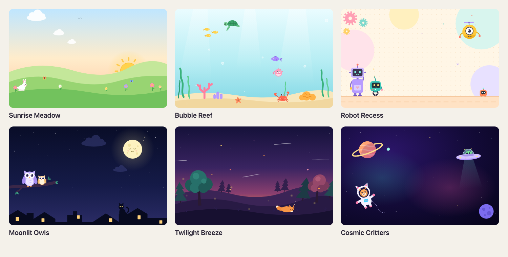

# Put an animated wallpaper behind your Claude chats

**The job it takes off your plate:** making the Claude app look the way you want. You get six animated wallpapers to pick from, and Claude draws new ones for you from a one-line description.

The wallpapers are drawn in code, so they move: a sun rises, fish swim past, robots roll across the floor. No image generator and no extra accounts are involved.

## Set it up

You need the Claude desktop app, up to date. Wallpapers also show in the Claude mobile app. They do not show in a terminal.

1. In Claude Code, add the library once (skip this if you already have):
   `/plugin marketplace add gabeomat/futureproof-workflows`
2. Install this workflow:
   `/plugin install animated-wallpapers@futureproof-workflows`
3. Start a new chat. The first wallpaper appears behind it, and a Wallpapers panel opens beside the chat.

There's nothing to connect.

## Use it

**Pick a wallpaper.** Type `/wallpaper` to open the panel. It shows the current wallpaper large, with all of them underneath. Click a name to switch. Your pick is remembered for your next chats.

You can also switch by typing:

| Type | What happens |
|---|---|
| `/wallpaper owls` | Switches to the wallpaper with that name |
| `/wallpaper next` | Switches to the next one |
| `/wallpaper off` | Takes the wallpaper off |
| `/wallpaper close` | Closes the panel |

**Make your own.** Type `/wallpaper new` and say what you want:

> /wallpaper new a sleepy dragon in a library, at night

This puts a ready-made request in the message box. Press Enter and Claude plans the scene, draws it, takes a picture of it to check its own work, fixes what looks wrong, and adds it to your panel. It takes a few minutes.

Just asking in plain words works too: "make me a wallpaper of a lighthouse in a storm."

**Change or remove one.** Say what you want in plain words:

> Make the dragon bigger and add more candles.
>
> Do Bubble Reef again, but at night.
>
> Remove my dragon wallpaper.

The six starters always stay. A changed starter is saved as a new wallpaper with its own name.

## The six starters

| Wallpaper | Scene | What moves |
|---|---|---|
| Sunrise Meadow | Bright | A sun rises over green hills, a bunny hops through the flowers, clouds and butterflies drift |
| Bubble Reef | Bright | Fish, a sea turtle and a puffer swim past, a crab waves its claws, bubbles rise |
| Robot Recess | Bright | One robot rolls across the floor, one hovers, one waves, a small one bounces, gears turn |
| Moonlit Owls | Night | Two owls blink on a branch under a glowing moon, a rooftop cat flicks its tail |
| Twilight Breeze | Night | Trees bend in the wind, leaves blow past, fireflies glow, a fox sleeps |
| Cosmic Critters | Night | An astronaut cat drifts past a ringed planet, a rocket and a waving alien |

## Good to know

- **One backdrop at a time.** If you have another add-on that changes Claude's background, turn it off, or the two will take turns overriding each other.
- **Your light or dark setting stays yours.** Each wallpaper adjusts the app's panels and text colors to suit it in both modes.
- **Checking a new wallpaper needs a browser.** Claude takes its picture with Chrome, Edge, Brave or Chromium if one is installed. Without one, it still makes the wallpaper and asks you how it looks.
- **What this add-on does on your computer.** It changes how the Claude app looks, reads the wallpaper files Claude writes in your working folder (a `wallpaper-drafts` folder), runs your browser in the background to take a picture, and keeps your wallpapers in its own settings file. Like any Claude Code add-on of this kind, it runs with the same access as Claude Code itself.
- **If `/wallpaper` isn't recognised or no wallpaper shows,** update the Claude desktop app and start a new chat. This was built and tested on Claude Code 2.1.325.
- **To remove it,** open `/plugin` and uninstall it. The app goes back to its own look.

## Watch the walkthrough

VIDEO LINK

## Make it yours

What would you change about this for your business?
